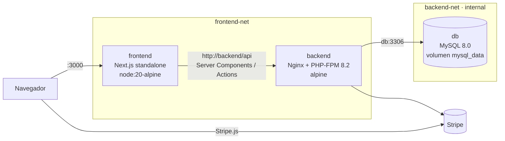

# Ecosistema E‑commerce dockerizado (Next.js 16 + Laravel 12 + MySQL 8)

Entorno de producción reproducible con **builds multi‑stage**, imágenes ligeras, usuarios sin privilegios y orquestación con un solo comando.

## Arquitectura de contenedores



- **frontend‑net**: frontend ↔ backend. **backend‑net** (`internal: true`): backend ↔ db, sin salida a Internet y sin acceso desde el frontend.
- MySQL **no publica** el puerto 3306 al host.
- El frontend hace todas las llamadas a la API desde el **servidor** de Next (Server Components/Actions), por eso usa el nombre de servicio `backend` y no `localhost`.

## Estructura del repo

```
.
├── docker-compose.yml
├── .env.example
├── frontend/      # código Next.js + Dockerfile + .dockerignore
├── backend/       # código Laravel + Dockerfile + .dockerignore + docker/{nginx,php,supervisord,entrypoint}
└── db/init/       # scripts SQL opcionales (/docker-entrypoint-initdb.d)
```

## Ejecución

```bash
cp .env.example .env
# Edita .env: contraseñas, APP_KEY, claves de Stripe
docker compose up -d --build
docker compose ps            # espera a que backend y frontend estén "healthy"
```

- Frontend: http://localhost:3000
- API: http://localhost:8000/api (health: `/up`)
- Seeders (opcional): `docker compose exec backend su-exec www-data php artisan db:seed --force`
- Apagar: `docker compose down` (conserva datos) · `docker compose down -v` (borra el volumen)

## Decisiones técnicas

### Frontend (`frontend/Dockerfile`)
| Decisión | Motivo |
|---|---|
| 3 etapas: `deps` → `builder` → `runner` | La imagen final no contiene `node_modules` completos, TypeScript, ni código fuente. |
| `COPY package*.json` + `npm ci` antes de `COPY . .` | La capa de dependencias solo se reconstruye si cambia el lockfile → builds rápidos. |
| Cache mount de npm (BuildKit) | Reutiliza descargas entre builds. |
| `output: "standalone"` y `node server.js` | Next copia solo las dependencias que realmente se importan; es el equivalente optimizado de `next start`. |
| `ARG NEXT_PUBLIC_STRIPE_KEY` en el builder | Las variables `NEXT_PUBLIC_*` se incrustan en build; en runtime ya no tendrían efecto. |
| Usuario `nextjs` (uid 1001), `cap_drop: ALL` | Reduce superficie de ataque. |
| `HEALTHCHECK` con `wget` (busybox) | No añade paquetes a la imagen. |

### Backend (`backend/Dockerfile`)
| Decisión | Motivo |
|---|---|
| Etapa `vendor` con `composer:2` | Composer, git y unzip no llegan a la imagen final. |
| `composer.json/lock` primero, luego el código | Cachea la instalación de dependencias. |
| `--no-dev --optimize --classmap-authoritative` | Autoloader rápido y sin dependencias de desarrollo. |
| Solo `vendor/` se copia desde la etapa de build | Cumple el requisito; el código se copia desde el contexto filtrado por `.dockerignore`. |
| Solo `pdo_mysql` y `opcache` se instalan | `mbstring`, `openssl`, `tokenizer`, `xml`, `ctype` y `json` ya vienen compilados en `php:8.2-fpm-alpine` (verifícalo con `php -m`). |
| Nginx + PHP‑FPM con `supervisord` | Un único servicio "backend" accesible por HTTP; Nginx solo ejecuta `index.php` y bloquea archivos ocultos. |
| `opcache.validate_timestamps=0` | Imagen inmutable → máximo rendimiento. |
| `config:cache` / `route:cache` en el entrypoint | Las variables de entorno llegan en runtime, por eso no se cachea en build. |
| Logs a stdout/stderr (`LOG_CHANNEL=stderr`) | Compatible con `docker logs` y agregadores. |
| `APP_KEY` obligatorio | El contenedor falla rápido si falta. |
| `.env` jamás entra a la imagen | Está en `.dockerignore`; la config llega por variables de entorno. |

### Base de datos
- `mysql:8.0` oficial, configurada solo con variables de entorno.
- Volumen nombrado `mysql_data` → `/var/lib/mysql` (persistencia).
- `healthcheck` con `mysqladmin ping` + `depends_on: service_healthy` → el backend no arranca hasta que MySQL acepta conexiones.
- Los scripts de `db/init/` solo se ejecutan en la primera inicialización; el esquema lo gestionan las migraciones de Laravel.

## Medición de resultados

```bash
docker images | grep ecommerce
docker history ecommerce-frontend:latest
docker history ecommerce-backend:latest
```

| Imagen | Antes (Dockerfile básico) | Después (multi‑stage) |
|---|---|---|
| frontend | _completar_ | _completar_ |
| backend | _completar_ | _completar_ |

Para medir el efecto de caché: cambia un archivo de `app/` o `components/` y repite `docker compose build`; las capas de dependencias deben aparecer como `CACHED`.

## Notas de producción
- Detrás de HTTPS (reverse proxy/ingress): la cookie de sesión del frontend se marca `Secure` en producción.
- Quita la publicación del puerto del backend si no necesitas acceder a la API desde el host.
